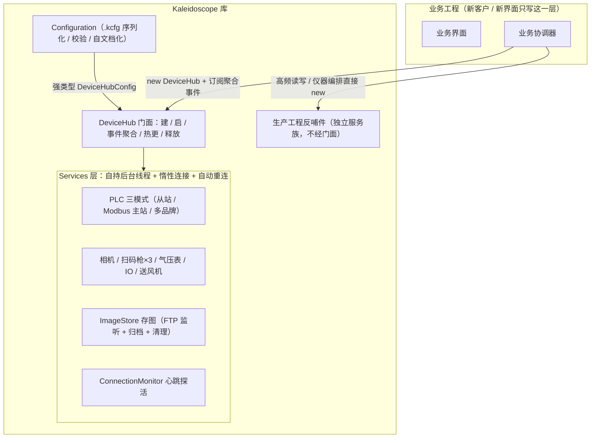

<div align="center">

# Kaleidoscope

**工业上位机 .NET 设备通讯通用库——换新客户、做新界面时,底层服务一行不改,只写 UI 和业务编排**


从生产级 WinForms 上位机工程持续反哺沉淀的通讯库:PLC(三种模式)+ 基恩士 IV4 相机 + 扫码枪三通道
+ 图片存储 + 九类实验室/产线仪器,一台 `DeviceHub` 门面接完;PLC 三拍握手、半开连接根治、
相机判定即写、存图清理防误删等上百条现场踩坑经验已经内置在库代码里,接入即受益。

</div>

---

## 快速开始

```powershell
# ① 构建类库（仓库根执行；MSBuild 路径随本机 VS 安装位置调整，
#    依赖在 Kaleidoscope/libs/ 内本地引用，无需 NuGet restore，离线可编译）
msbuild Kaleidoscope/Kaleidoscope.csproj /p:Configuration=Debug /p:Platform=AnyCPU /t:Build /nologo /v:m /m

# ② 构建后运行 Demo 测试台（引用库的 bin 输出；同样是 msbuild 构建 Demo/KaleidoscopeDemo.csproj）
Demo\bin\Debug\KaleidoscopeDemo.exe

# ③ 跑 152 用例一键回归（改任何库代码后、提交前必须全 PASS：PASS=152 FAIL=0）
powershell -File .opencode/skill/acceptance-test/scripts/run-smoke.ps1
```

## 它能做什么

- **七类设备整包（`DeviceHub` 门面）**：PLC、相机、扫码枪、图片存储、气压表、IO 耦合器、送风机，
  一个门面建好、启动、聚合事件、热更、释放全链路封装，新项目只写 UI 和业务编排；
- **PLC 三种模式**：Modbus TCP 从站（被动响应 PLC 主站轮询）、Modbus TCP 主站（主动读写+自动轮询）、
  多品牌主站（三菱/欧姆龙/西门子/汇川协议），配置里一个字段切换，业务代码不变；
- **九类生产工程反哺件**：统一读写队列、TCP/EIP 通用通道、耐压绝缘、气密、柔性供料震动盘、
  激光打码、串口光源、IDMVS 读码器、统一读码抽象——在真实产线多轮迭代验证过的独立服务族；
- **配置即数据的工程化体验**：强类型配置 + 内置 `.kcfg` 序列化（零第三方依赖）+ 保存前校验
  + 配置自文档化（新增字段自动出现在说明书里）；
- **配套工具箱**：`Demo/` 接入骨架测试台、`ConfigEditor/` 可视化配置编辑器（自动渲染参数界面
  + 品牌预设一键填充）、`ConnectionMonitor/` 全设备心跳与自动重连；
- **离线可编译**：第三方依赖 DLL 全部随 `libs/` 引用，现场无网络也能构建；
- **模拟通讯**：不接任何真设备也能把 UI 和业务流程跑通（气压表/IO/送风机自动换 Mock 实现，
  随机数据模拟），接真机改回一个布尔开关即可。

## 架构



- **分层不可破坏**：业务层禁止新建 `TcpClient`/串口/连接（服务内部惰性建连 + 自动重连），
  UI 线程禁做网络 IO，事件一律在工作线程触发；
- **统一真相源**：三种 PLC 模式连接状态都聚合为同一指示灯，热更/释放行为一致。

## 仓库结构

```text
kaleidoscope/
├── Kaleidoscope/          # ★ 类库工程（net472；libs/ 本地引用，离线编译）
│   ├── Models/            #   强类型配置模型（每个字段带中文说明元数据）
│   ├── Configuration/     #   .kcfg 序列化 + 保存前校验 + 设备说明书自动导出
│   ├── Services/          #   全部设备通讯服务（含生产工程反哺件）
│   ├── Utils/             #   日志出口 / Mock 桥 / 串口识别 / TCP KeepAlive
│   └── libs/              #   NModbus / NModbus.Serial / NModbus4 / HslCommunication
├── Demo/                  # WinForms 测试台（按标准接入方式写的最小界面，可直接抄骨架）
├── ConfigEditor/          # 可视化配置编辑器（不进库、不启停设备，只产 .kcfg）
├── docs/                  # 设备协议文档（寄存器映射 / 坑点 / 排障）
├── 使用说明.md            # 完整接入手册（配置逐项 / 业务写法 / FAQ）
├── AGENTS.md              # AI / 维护约定（架构约束、注释红线、已知通讯关键点）
└── CHANGELOG.md           # 版本记录（V1.0.0 起全部改动留痕）
```

## 快速接入（DeviceHub · 四步）

```csharp
// ① 构造：传入聚合配置即建好全部服务（惰性连接，不碰网络）
var hub = new DeviceHub(LoadDeviceConfig());

// ② 启动：扫码枪连接 + 心跳监控 + 存图定期清理 + PLC 主站轮询
hub.Start();

// ③ 订阅聚合事件（可选，事件在工作线程触发，UI 订阅方需 Invoke 回 UI 线程）
hub.SerialNumberScanned     += (s, code) => UpdateUi(code);
hub.DeviceConnectionChanged += (s, e) => UpdateStatusLamp(e);
hub.ServicesRebuilt         += (s, e) => RebuildBusinessLayer(hub);

// ④ 关窗释放（固定顺序，各步异常不中断）
hub.Dispose();
```

业务层使用 `hub.Plc` / `hub.PlcMaster` / `hub.PlcMultiBrand` / `hub.Cameras` / `hub.Scanners`
/ `hub.Barometer` / `hub.Io` / `hub.Fan` / `hub.ImageStore`，**不要**自己新建连接。

### 配置读写（库内置，零第三方依赖）

```csharp
var cfg = ConfigSerializer.Load(path);   // 读：文件不存在自动回缺省；缺新版字段自动补默认值
ConfigSerializer.Save(cfg, path);        // 写：UTF-8 无 BOM，中文可直读、可手工编辑
DeviceHubConfigValidator.Validate(cfg);  // 保存前校验：错误必须修、警告建议修
hub.ApplyConfig(cfg);                    // 转手给 DeviceHub
```

没配置文件也不怕：`ConfigSerializer.Load` 读的对象自动回退全部缺省值（开箱即用免手工初始化），
逐项配置说明见 [`使用说明.md`](./使用说明.md)。

### PLC 三种模式

配置里 `DeviceHubConfig.PlcRole` 一个字段决定上位机与 PLC 的关系（默认 `Slave` 兼容老项目）：

| PlcRole | 角色 | 业务层入口 | 关键点 |
| --- | --- | --- | --- |
| `Slave`（默认） | Modbus TCP **从站**，被动响应 PLC 主站轮询 | `hub.Plc` | "请求-结果-复位"三段式握手 |
| `Master` | Modbus TCP **主站**，主动读写 PLC | `hub.PlcMaster` | 启动即自动轮询，断线自愈回传 |
| `MultiBrand` | **多品牌主站**：三菱/欧姆龙/西门子/汇川协议 | `hub.PlcMultiBrand` | 地址填品牌语法，心跳自愈定时器 |

多品牌模式使用 HslCommunication（**商业授权，授权码需自行购买**，经编辑器弹窗输入后
AES 加密存放于 exe 同目录 `hsl.dat`，支持查看/复制/多机共用）；不使用该模式则完全无授权依赖。

### 模拟通讯（无设备也能跑）

配置 `UseMockCommunication = true`：气压表 / IO 耦合器 / 送风机自动换 Mock 实现（随机数据模拟），
UI、业务流程、界面布局全部跑通；接真机改回 `false`，业务代码一行不动。

### 热更（改配置免重启）

```csharp
hub.ApplyConfig(newConfig);
```

库内自动按固定顺序释放旧服务 → 全量重建 → 重新订阅聚合事件 → 触发 `ServicesRebuilt`；
业务方只需在该回调里重建自己的业务协调器。

## 生产工程反哺件（独立服务族）

> 这些服务**不经 `DeviceHub` 门面**——门面专注"换新客户，七类设备整包"；反哺件
> 是在真实生产工程中多轮迭代验证过的能力，适合"生产节拍高频读写 / 仪器测试编排"类业务，
> 宿主工程直接 new 并自管生命周期。

| 服务 | 作用 | 关键设计 |
| --- | --- | --- |
| `PlcNetCommQue` | 多品牌 PLC + 裸 TCP 统一读写队列：常驻消费线程串行执行，读请求结果槽+句柄唤醒（永不死等） | 适合生产节拍高频、多来源、严格顺序；另有静态 `IsPlcConnectedAt(index)` 连接态查询 |
| `TcpChannel` | 通用 TCP / EtherNet-IP 通道（裸收发 / 周期读） | 禁自重连：断线只报事件，重连策略归上层统一管 |
| `DeviceServiceBase` | 全族仪器服务基类（停止旗 / 日志注入 / 节流 / 限时退出 / Mock 短路） | 新仪器服务一律继承它 |
| `HipottestService` | 耐压绝缘/微电阻（SCPI 协议）：完成边沿状态机 + 指纹变化判批 | 经现有连接测试、按需读批 |
| `AirtightService` | 气密测试：IO 经 PLC 或 Modbus 直连双分支、结果邮箱 | 延时通知 + 序号认领 |
| `VibFeederController` | 柔性供料震动盘（Modbus TCP）：断连自愈冷却、纯时长制补料 | 停必验证 |
| `LaserMarkService` + `MarkContentHub` | 激光打码（TCP/串口双传输 + 完成信号判定）+ 打码内容交接中心 | 串口名动态识别 |
| `LedControl` | 串口光源驱动（通道 + 亮度指令） | —— |
| `CodeReaderClient` + `ICodeReader` | 读码器统一抽象：不同品牌读码器归一为"现在给我读一次码" | 换读码设备不改业务代码 |

**宿主桥接**：演示模式短路、日志出口全部走注入桥（`MockBridge` 三委托 / `LogHelper.LogAction`
/ `DeviceServiceBase.LogSink`）——库不依赖任何业务工程；推荐在宿主日志与 Mock 类的静态构造里接线，
进程内首次触碰即生效。

## 设备对接速览

| 设备 | 通讯方式 | 一句话要点 |
| --- | --- | --- |
| PLC | Modbus TCP 从站 / 主站 / 多品牌 | `PlcRole` 三选一，同一时刻只生效其一 |
| 相机 | 基恩士 IV4 无协议 TCP | 触发 → 判定 → 判定即写 PLC → 图异步归档 |
| 扫码枪 | TCP / 串口 / EtherNet-IP 三通道 | TCP 连上后发触发指令才读码；EIP 保持型数据自动去重 |
| 气压表 | Modbus RTU 主站（RS485→USB） | 串口按关键词 WMI 自动识别，换电脑自动找回 |
| IO 耦合器 | Modbus TCP 主站 | 单点写输出自动"读-改-写"，不踩同寄存器的其他输出 |
| 送风机 | Modbus TCP（非标准端口） | 寄存器映射与命令码全部可配，换厂商改配置不改库 |
| 图片存储 | FTP 目录监听 | 双格式归档 + 按天定期清理 + 防误删防线 |

各设备的寄存器地址、指令协议与百分百细节见 [`docs/通讯接入.md`](docs/通讯接入.md) 与 [`使用说明.md`](./使用说明.md)。

## 通用红线（内置在库行为里，接入方配合遵守）

1. **UI 线程禁做网络 IO**：所有连接/读写都在服务后台线程执行；
2. **事件在工作线程触发**：订阅方操作控件前必须 `Invoke` 回 UI 线程；
3. **图片一律后台解码 + 缩略图**：工业相机原图尺寸较大，直接全尺寸赋值会卡界面；
4. **业务层不补连接管理**：服务已内置惰性建连 + 自动重连 + 节流日志，上层只调公开方法。

## 测试

验收回归用例集固化于 `.opencode/skill/acceptance-test/scripts/`，一键运行、退出码可直接接 CI：

```powershell
powershell -File .opencode/skill/acceptance-test/scripts/run-smoke.ps1
```

- 判据 **`PASS=152 FAIL=0`** 为基线（个别授权用例因无授权环境自动 SKIP，属正常）；
- 失败用例名即定位（组.序号 + 场景描述）；改动库代码后、提交前必须全 PASS。

## 文档导航

| 文档 | 内容 |
| --- | --- |
| [`使用说明.md`](./使用说明.md) | 完整接入手册：配置逐项、业务层写法、HSL 授权、热更、FAQ |
| [`docs/通讯接入.md`](docs/通讯接入.md) | 设备协议文档：寄存器映射、坑点、排障 |
| [`Demo/README.md`](Demo/README.md) | 测试台使用与验收清单 |
| [`ConfigEditor/README.md`](ConfigEditor/README.md) | 可视化配置编辑器说明 |
| [`AGENTS.md`](AGENTS.md) | 维护 / AI 协作约定、已知通讯关键点（现场实测沉淀） |
| [`CHANGELOG.md`](CHANGELOG.md) | 版本记录：每次改动都留痕 |
